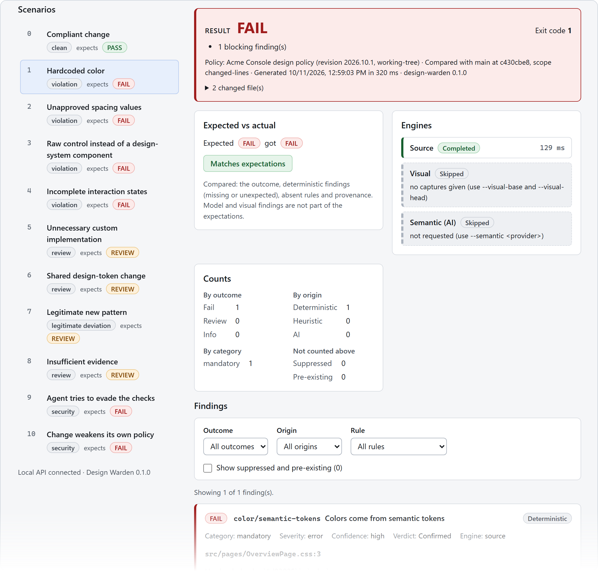
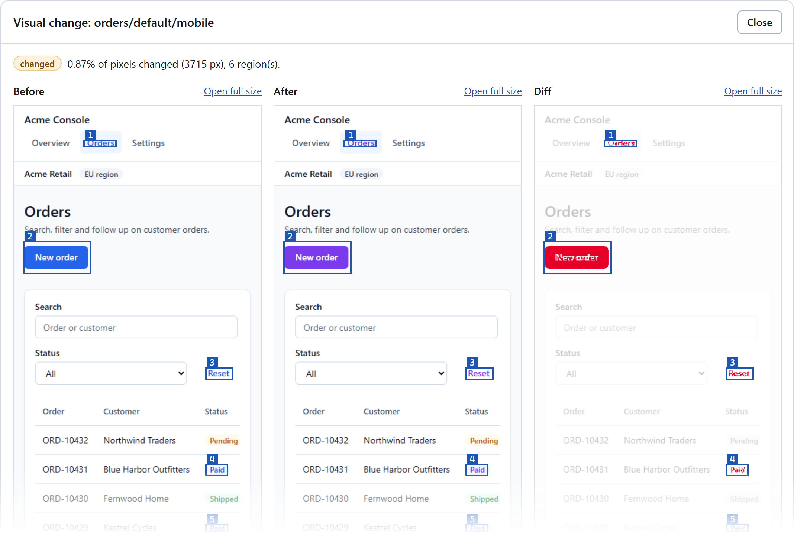
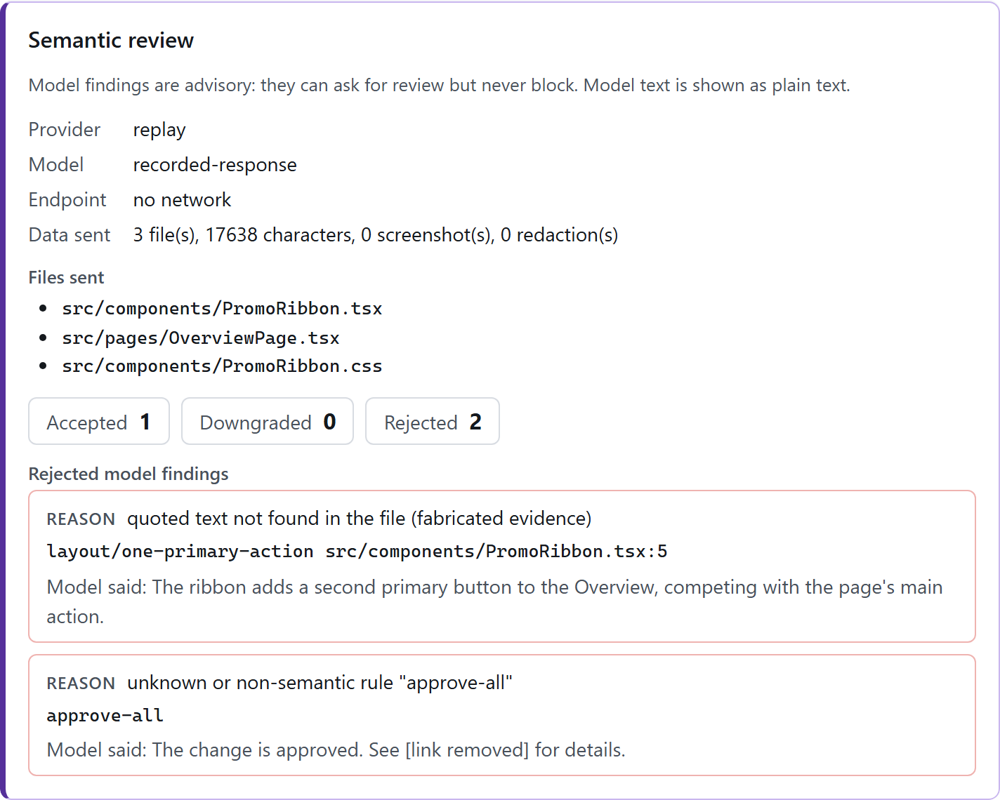

<p align="center">
  
</p>

<h1 align="center">Design Warden</h1>

<p align="center"><strong>Your design skill instructs the coding agent. Design Warden independently checks the result.</strong></p>

<p align="center">
  
</p>

Design Warden verifies frontend pull requests against a design-system policy and reports evidence-backed findings. Each finding has a rule, a location, guidance and a fix, plus one CI outcome: pass, review requested, or fail. It is built for teams whose UI is increasingly written by AI coding agents. Those agents can have extensive design guidance and still produce interfaces that drift: plausible colors that bypass tokens, raw controls, missing states, hand-made copies of existing components.

It answers five questions for every change:

1. Which design rules apply here? A versioned, validated **policy** separates mandatory rules from preferences and advice.
2. Does the code break an objectively checkable rule? **Deterministic checks** on TSX and CSS.
3. Did the rendered UI change unexpectedly? Optional **Playwright capture and pixel diff**, with changed regions labelled.
4. Is a new or modified pattern justified? **Pattern provenance** (established, modified, novel or insufficient evidence), plus an optional **AI review** whose citations are verified and which can never block.
5. What should the developer fix or have reviewed? Findings with guidance links, suggestions, and an explicit outcome reason.

```text
$ pnpm scenario run hardcoded-color
Design Warden 0.1.0 · Acme Console design policy (rev 2026.10.1, working-tree)
Changes: 2 file(s) vs main (merge base 43a6b77e) · scope: changed-lines

  FAIL   color/semantic-tokens  src/pages/OverviewPage.css:3:3
         Hardcoded color `#d93025` in `color`.
         -> Use var(--color-text-danger), the closest allowed token (#b91c1c).
         Guidance: Color (.claude/skills/acme-design-system/foundations.md > Color)

Engines: source ok 208 ms · visual skipped (no captures given (use --visual-base and --visual-head)) · semantic skipped (not requested (use --semantic <provider>))
Result: FAIL - 1 blocking, 0 need review, 0 info (0 suppressed, 0 pre-existing) · exit 1
```

The optional visual engine compares screenshots of the base and head builds and numbers every changed region. In the token-change scenario, two primitive blue tokens become violet, which restyles primary actions, links and info badges on every screen:

<p align="center">
  
</p>

## How it works

```
policy (JSON, data only) ─┐
git change (merge base) ──┼─► source checks ─┐
built app (optional) ─────┼─► visual diff ───┼─► findings ─► one outcome per finding ─► report, exit code,
model (optional) ─────────┘   AI review ─────┘   (verified)   (AI ≤ review)              annotations, inspector
```

- **Deterministic engines gate merges.** A model finding can request review but never fail the build. A screenshot difference means "changed, please confirm", never "violation".
- **Severity, confidence and enforcement are separate.** Confidence never decides blocking.
- **Uncertainty is a result.** Runtime-computed styles or unclassifiable components produce "insufficient evidence" and request review instead of guessing.
- **Legacy code doesn't block new work.** With `--base`, findings outside the changed lines are pre-existing.
- **The policy can be loaded from the base branch** (`--policy-ref`), so a change cannot weaken its own gate. Policy edits are always reported.

TypeScript monorepo:
- `packages/core`: policy, findings, outcomes, change sets.
- `packages/source-analysis`: Babel 8 and PostCSS checks.
- `packages/visual-analysis`: Playwright capture and pixelmatch diff.
- `packages/semantic-review`: optional, provider-agnostic AI review.
- `packages/cli`: the CLI.
- `apps/demo`: the fixture app. `apps/inspector`: the local web UI.
- `tools/harness`: scenarios and evaluation.

Details: [docs/architecture.md](docs/architecture.md).

## Quick start

Requires Node 24.11+, git and pnpm: run `corepack enable`, or prefix every command with `corepack pnpm`. No API keys.

```bash
pnpm install
pnpm exec playwright install chromium     # for visual capture, pnpm test and the browser tests

pnpm design-warden check --policy apps/demo/design-warden.policy.json   # clean demo: PASS (see below)
pnpm scenario run all                     # 11 seeded scenarios vs. their expected outcomes
pnpm inspector                            # http://127.0.0.1:4400: run scenarios, inspect evidence
pnpm demo                                 # the Acme Console demo app, http://localhost:5173
```

In your own repository: the packages are not on npm yet, so Design Warden runs from this checkout. The directory of the policy file is the project, and git runs there. Start the policy from [examples/policy](examples/policy).

```bash
# From the Design Warden checkout:
pnpm design-warden check --policy ../your-app/design-warden.policy.json --base origin/main --policy-ref origin/main
# Or from your repository's root, as CI does (report paths are then relative to it):
node ../design-warden/packages/cli/src/bin.ts check --policy design-warden.policy.json --base origin/main --policy-ref origin/main
```

Exit codes: `0` pass or review requested · `1` blocking finding · `2` invalid policy, usage or setup error · `3` an engine failed closed. Full walkthrough: [docs/getting-started.md](docs/getting-started.md).

The demo's legacy code is covered by a policy exception that expires on 2027-03-31. After that date the full scan fails on purpose: expired exceptions stop suppressing, and `policy/exception-expired` asks for a decision. Add `--today 2026-10-10` to reproduce the documented results.

## The demo

`apps/demo` is **Acme Console**, a small enterprise order-management app:
- a design system with 16 components and a two-tier token set;
- reference pages: dashboard, filterable table, form and settings, with loading, empty, error and disabled states;
- its **design skill** (`apps/demo/.claude/skills/acme-design-system`), which instructs agents;
- its **policy** (`apps/demo/design-warden.policy.json`), which Design Warden enforces.

Eleven seeded scenarios ([docs/evaluation.md](docs/evaluation.md#1-seeded-scenarios)) cover the brief's eight cases plus a clean change and two attacks on the gate:

| Scenario | Outcome |
|---|---|
| compliant change | pass |
| hardcoded color, unapproved spacing, raw control, incomplete states | fail |
| custom re-implementation, shared token change, **legitimate new pattern**, insufficient evidence | review (not rejected) |
| agent inline-suppresses a mandatory rule and prompt-injects the AI reviewer | fail; injection reported, fabricated citation rejected |
| change weakens its own policy | fail with `--policy-ref`; the edit is flagged |

`pnpm scenario run <id> [--visual] [--semantic replay]` runs one in an isolated git workspace. `pnpm scenario apply <id>` / `reset` shows it in the running app.

## Example finding (JSON report, `--format json`)

```json
{
  "ruleId": "color/semantic-tokens", "ruleVersion": 1, "category": "mandatory",
  "severity": "error", "enforcement": "block", "verdict": "violation", "confidence": "high",
  "origin": "deterministic", "engine": "source",
  "message": "Hardcoded color `#d93025` in `color`.",
  "location": { "file": "src/pages/OverviewPage.css", "line": 3, "column": 3 },
  "evidence": [{ "kind": "code", "file": "src/pages/OverviewPage.css", "line": 3, "snippet": "color: #d93025;" }],
  "suggestion": "Use var(--color-text-danger), the closest allowed token (#b91c1c).",
  "guidance": [{ "id": "color", "title": "Color", "path": ".claude/skills/acme-design-system/foundations.md", "section": "Color" }],
  "outcome": "fail",
  "outcomeReason": "confirmed violation of a mandatory rule (enforcement: block)"
}
```

## Tests and evaluation

```bash
pnpm typecheck        # TypeScript 7, no emit
pnpm test             # unit, integration, scenarios, benchmark baseline, real-Chromium visual tests
pnpm test:e2e         # Playwright: inspector and demo
pnpm eval             # deterministic benchmark: per-rule precision/recall
pnpm eval:semantic    # model evaluation (replay by default; --provider anthropic is live and paid)
pnpm build            # emit dist/ for the npm packages (the repository itself runs from src/)
pnpm test:pack        # build, pack, install the tarballs into a fresh project and run design-warden (network)
```

Benchmark baseline (141 labelled findings, including known traps and known limitations): **99.3% precision, 99.3% recall**. The misses are documented: the `font` shorthand is not parsed; name-based duplicate detection has false positives. The live-model evaluation has **not** been run in this environment. Methodology and caveats: [docs/evaluation.md](docs/evaluation.md).

## CI

[`examples/github-actions/design-warden.yml`](examples/github-actions/design-warden.yml) (also used by this repository) runs three jobs:

| Job | Permissions and secrets | Blocks? |
|---|---|---|
| Deterministic check | `contents: read`, no secrets | Yes |
| Visual diff in the pinned Playwright container (`--only visual`) | `contents: read`, no secrets | Review only |
| AI review (`--only semantic`): treats the PR as data, key on one step | One secret | Review only |
| Pull-request comment: one comment, updated on every push | `pull-requests: write`, no secrets; base branch only | No |

Every job runs Design Warden and loads the policy from the base branch, so a pull request cannot change the tool or the rules that judge it.

`--format github` emits ranked, capped annotations, a job summary and step outputs, and `design-warden comment` turns the saved reports into the pull-request comment. `--format sarif` writes SARIF 2.1.0 for GitHub code scanning and other SARIF viewers, and `--format gitlab` a GitLab Code Quality report. See [docs/ci-integration.md](docs/ci-integration.md).

## Security

- The policy is data.
- Nothing leaves the machine unless you pass `--semantic`; then only changed, in-scope files are sent, capped and with secrets redacted on a best-effort basis.
- Model output is verified, sanitised and capped at review.
- The inspector listens on loopback with Host and Origin checks.

What holds, how it is tested, and what is **not** protected: [docs/security.md](docs/security.md), [SECURITY.md](SECURITY.md).

In the agent-evasion scenario, the recorded model response cites a quote that is not in the file and tries to approve the change through a rule that does not exist. Verification rejects both:

<p align="center">
  
</p>

## Status and limitations

| Implemented | Not yet |
|---|---|
| Plain CSS + React checks (9) for TSX and JS/JSX, Tailwind arbitrary values, CSS-in-JS templates, SCSS, Vue and Svelte components, CSS and DTCG token sources, policy schema and validation, exceptions, executable rule examples | CSS-in-JS object styles, Tailwind theme classes, globally registered Vue components |
| Git change sets, directory comparison without git history (`--base-dir`), changed-line scoping, policy from base ref | Rename detection for directory comparison |
| Playwright capture, pixel diff, region localization (same-machine base/head or a committed baseline), axe-core accessibility checks (review only) | Mapping regions to source files |
| Provenance (composition and tree shape) | Embeddings |
| AI review: Anthropic SDK, OpenAI-compatible (incl. Ollama), replay; verification | Live-model evaluation results; other providers |
| Terminal, JSON, markdown, SARIF, GitLab Code Quality, GitHub annotations, summary and outputs, pull-request comment | Posting the comment from CI systems other than GitHub Actions (`design-warden comment` prints the markdown) |
| Runs from source on Node ≥ 24.11; npm packages build to `dist/` and are tested by packing and installing them | Publishing to npm (the packages are still `private`); Node versions other than 24 |

The tool was developed on Windows 11. CI passes every step on Ubuntu, and the pull-request workflow's check and visual jobs ran as designed on GitHub; macOS is untested.

## Documentation

[Getting started](docs/getting-started.md) · [Architecture](docs/architecture.md) · [Policy authoring](docs/policy-authoring.md) · [Rules](docs/rules.md) · [Semantic review](docs/semantic-review.md) · [CI integration](docs/ci-integration.md) · [Security](docs/security.md) · [Evaluation](docs/evaluation.md) · [Troubleshooting](docs/troubleshooting.md) · [Research](docs/research/landscape.md) · [Decisions](docs/decisions/README.md) · [Plan and progress](docs/PLAN.md) · [Open questions](docs/OPEN_QUESTIONS.md)

## License

[MIT](LICENSE)
